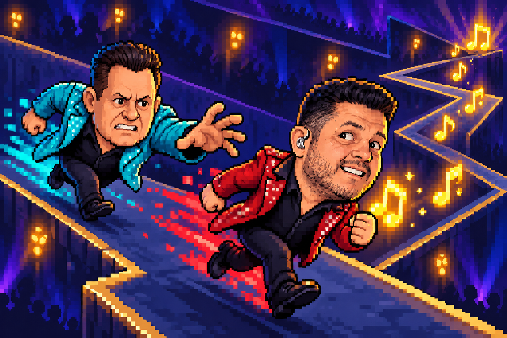

# B&M RUN 🎵

**Uma voz roubada. Uma fuga em zigue-zague. Nenhuma nota pode ficar para trás!**

Jogo 2D de perseguição musical desenvolvido em Unity para o projeto individual **Introdução ao Unity**, da disciplina de Jogos do **Insper — 2026.2**.

- **Autor:** Matheus de Souza Lemos
- **Jogar no navegador (itch.io):** [B&M RUN](https://mathlemos.itch.io/bm-run)
- **Código-fonte:** [MathLemoss/tutorial_ML](https://github.com/MathLemoss/tutorial_ML)

## História

Bruno e Marrone brigaram… e Bruno roubou a voz de Marrone! Furioso, Marrone persegue o parceiro pelo mapa. Na pele de Bruno, fuja em zigue-zague e recolha notas musicais para reconstruir a música e escapar.

## Como jogar

1. No menu inicial, selecione **Jogar** e escolha uma música.
2. Pressione **Espaço** ou **A** para começar. Bruno avança automaticamente em diagonal.
3. Cada novo toque alterna entre subir e descer. Desvie das paredes e colete as notas.
4. Cada nota vale **100 pontos** e libera o próximo trecho da música, em sequência. Se os trechos liberados acabarem, a reprodução espera uma nova coleta.
5. Perder uma nota aproxima Marrone e ativa o suspense. Coletar a próxima afasta Marrone e zera a sequência de falhas.
6. **Bater na parede ou perder duas notas consecutivas causa derrota. Complete a reprodução da música para vencer!**

O corredor começa amplo e fica mais estreito conforme a partida avança. A velocidade de Bruno permanece constante.

Durante o jogo, a interface mostra pontos, notas coletadas, falhas consecutivas, tempo e progresso musical. Ao terminar, aparecem o resultado, o tempo final e a pontuação. Use **Reiniciar** para tentar a mesma música novamente ou **Menu** para escolher outra.

## Controles

| Ação | Teclado | Controle Xbox |
|---|---|---|
| Iniciar a partida e alternar a diagonal | Espaço | A |
| Navegar pelos menus | Setas | Direcional ou analógico |
| Selecionar uma opção | Enter | A |
| Voltar nas telas do menu | Esc | B |

## Músicas

As opções aparecem em ordem crescente de duração:

| Música | Duração do áudio utilizado |
|---|---|
| Boate Azul | 1:50 |
| Programa de Fim de Semana | 3:13 |
| Dormi na Praça | 3:28 |

## Créditos e referências

### Base didática

Projeto desenvolvido a partir do [tutorial “Introdução Rápida” da disciplina](https://slender-ceder-1da.notion.site/Tutorial-Introdu-o-R-pida-1a6d1ae1773780a7a59cf823a8b599ec?pvs=4), com adaptações de tema, movimento, percurso, perseguição, áudio e interface.

### Imagens

| Recurso | Fonte e utilização |
|---|---|
| Notas musicais | Pinterest |
| Foto de Bruno | [Wikipédia — Bruno (cantor)](https://pt.wikipedia.org/wiki/Bruno_%28cantor%29) |
| Foto de Marrone | [Show Sertanejo — Bruno e Marrone](https://showsertanejo.com.br/cantores/bruno-e-marrone/) |

### Áudios

| Recurso | Fonte |
|---|---|
| Músicas — Bruno & Marrone | [Canal no YouTube](https://www.youtube.com/channel/UCdTX5ycRKPvTUiGu1519u4g) |
| Vitória | [Vídeo de origem](https://www.youtube.com/watch?v=cAU_bd6I720) |
| Derrota | [Vídeo de origem](https://www.youtube.com/watch?v=AzNTmKhFwQg) |
| Suspense | [Vídeo de origem](https://www.youtube.com/watch?v=7y4kJtkioFk) |